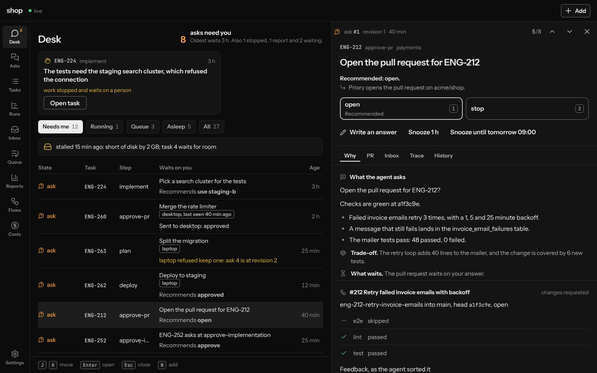
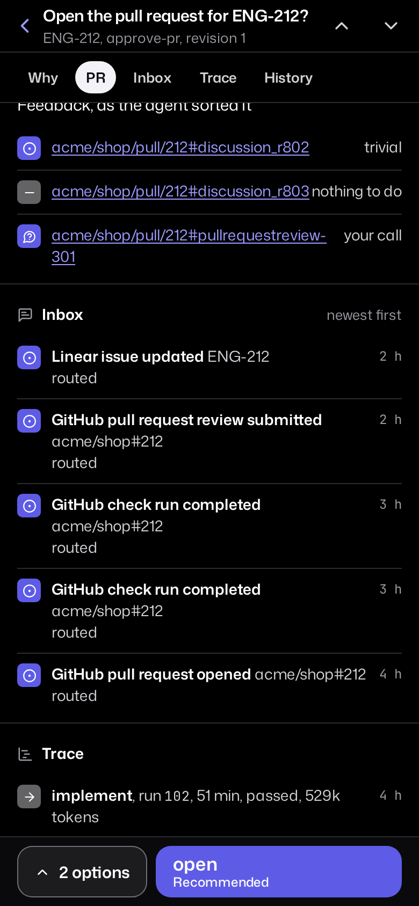
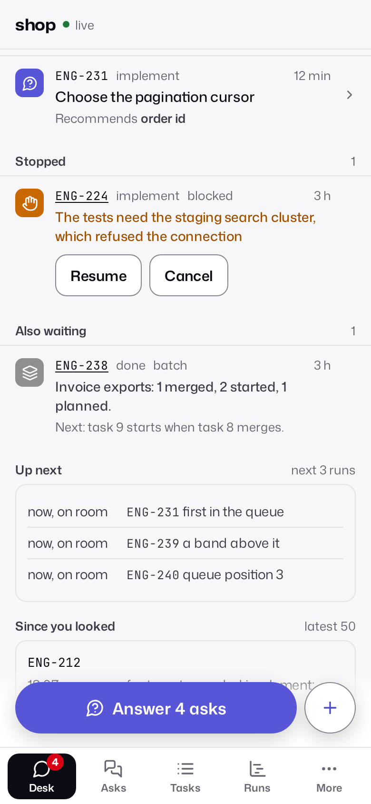
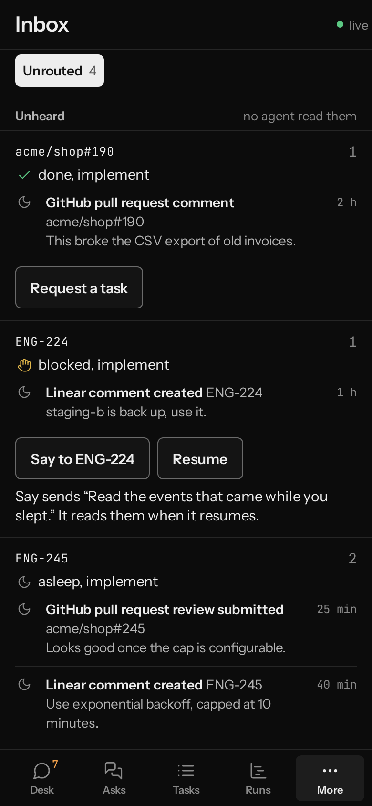
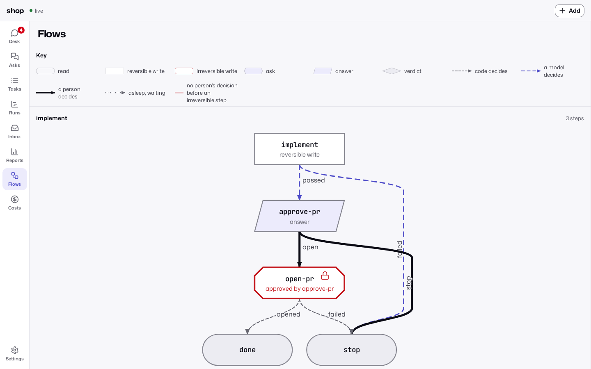

<h1>
  <picture>
    <source media="(prefers-color-scheme: dark)" srcset="design/logo/lockup-dark.svg">
    
  </picture>
</h1>

Priory runs coding agents, such as Claude Code and Codex, on machines you own. It turns events
into tasks: a labelled GitHub issue, a Linear issue that enters a view, a Slack message, a schedule
or a request you type. It then carries each task through a workflow you wrote, usually to a pull
request that a person reviews and merges.

Priory is a Rust program with two long-running processes. The intake polls GitHub, Linear, Slack
and your schedules. The daemon turns what the intake finds into tasks and runs one agent per task
in its own tmux session and git worktree.

## The problem it solves

Running one coding agent is easy. Keeping several of them moving while nobody watches is not. An
agent waits on CI, on a review or on a person's answer. It crashes, fills the disk or runs the
machine out of memory. A question it asks in its own terminal goes unseen.

Priory handles that work in deterministic code, not in a coordinator agent that spends tokens on
every poll:

- An agent that waits holds no process. It names what it waits for, such as a pull request's
  checks, and goes to sleep. The daemon resumes its session when that event arrives.
- Every question an agent asks lands on one list, the desk, with options and a recommendation.
  You answer it from the command line, or a trigger hands its tasks' questions to a lead agent and
  keeps only the irreversible ones for you.
- Every workflow step declares who decides it (a model, a person or code) and what it changes. So
  `priory check` can refuse a workflow before it runs, for example one that pushes code with no
  person's approval. `priory check --explain` lists what a person approves before each
  irreversible step.
- A step can refuse an agent's `passed` until the project's gate, such as its tests, passed at the
  branch's head. `priory check --explain` lists the outcomes the daemon verifies.
- A workflow can be a runbook of human steps only, where an answer runs a step's command once.
  The desk also holds your own to-dos, ranked after the asks.
- Every step's outcome, tokens and time are recorded, so you can measure a workflow and its cost.

## The web view

The daemon's HTTP server, set by `[serve]` in `factory.toml`, serves a web view that works on a
phone: the desk, asks, the inbox, flows and costs. These screenshots show `priory serve` on a demo
factory. Its design rules are in [DESIGN.md](DESIGN.md).




On a phone, an ask opens as a page with its recommendation and options. Scrolling keeps an answer bar at the bottom.




The desk shows a batch in progress as one row, with its counts and which entries start next. The
row opens the batch page, with each entry's state and when it starts. A batch's go ask shows its
plan as a lane graph, and you can move or drop an entry before you answer.



The inbox groups unrouted events by resource and offers actions to subscribe an existing task or request a new one.




Tasks lists every task by saved view and filter, and Runs lists the recent runs with their agent, model, outcome, duration and tokens. Each row opens its task.


Flows draw each workflow and mark who decides each edge and which step is irreversible. Costs show spend, merges and your attention.




## Get started

Install the prebuilt `priory` for Linux (x86_64 or aarch64) or macOS on Apple silicon into
`~/.local/bin`:

```sh
curl -fsSL https://raw.githubusercontent.com/maxence-lefebvre/priory/main/install.sh | sh
```

- [GETTING_STARTED.md](GETTING_STARTED.md): install or build Priory, write a first factory, run it, and the
  day to day commands and concepts. Once the factory has a `[request]` table,
  `priory add "Fix the typo in the README"`, or `N` in the web view, queues a first task. Its
  [phone section](GETTING_STARTED.md#use-it-from-a-phone) installs the web view on a phone, with
  notifications for new asks.
- [CONTRIBUTING.md](CONTRIBUTING.md): how to change Priory, the checks to run, and how pull
  requests work.
- [maxence-lefebvre.github.io/priory](https://maxence-lefebvre.github.io/priory/): these docs as a
  website, with search, built from `main`.

## Status

Priory is in early development. The milestones come from [docs/prd.md](docs/prd.md#milestones).

| Milestone | Scope | Status |
| --------- | ----- | ------ |
| M0 | One machine, tmux, Claude Code, CLI and GitHub intake, inbox, workflows, waits, asks, results, health | Done |
| M1 | Linear, Slack replies, schedules, queue order, holds, revive, lanes, bands, memory gate, agents slice, retiring tasks, traces, reports, nudges, repair, Codex | Done |
| M2 | Web view, webhooks, terminal attach, command answers, OpenTelemetry export, search | In progress: every feature has landed; its done-when test, one working day of asks answered from a phone only, is still open |
| M3 | Several machines, state adapters, shared skills and memories | In progress: a Postgres event log, and runners that own tasks through claims and leases on it, have landed |
| M4 | Risk estimate, scorers and benchmarks | Not started |

## Documentation

- [docs/prd.md](docs/prd.md): what Priory does, and in which milestone.
- [docs/reference/](docs/reference/README.md): every key of the factory's files, every intake
  message, and their JSON Schemas.
- [docs/daemon/](docs/daemon/README.md): how the daemon runs tasks, one file per topic.
- [docs/intake/](docs/intake/README.md): the messages the intake publishes, one file per source.
- [docs/trace-schema.md](docs/trace-schema.md): the format of trace records.
- [docs/adapters/herdr.md](docs/adapters/herdr.md): the Herdr adapter, Priory's panels as Herdr
  mods: Desk, Asks, Queue, Bonjour, Costs and Flows.
- [adapters/github/README.md](adapters/github/README.md): the GitHub extension, Priory on a pull
  request's page: its task, its asks and a review guide.
- [docs/evaluating-a-prompt.md](docs/evaluating-a-prompt.md): measure a change to a prompt Priory
  gives agents before you ship it. One case, once, on Haiku, for under ten cents:
  `cargo run -p priory -- eval crates/priory-core/src/nudge.eval.toml --case finished --runs 1 --budget 0.10`.
- [DESIGN.md](DESIGN.md): the design system of the web view.

## License

MIT. See [LICENSE](LICENSE).
