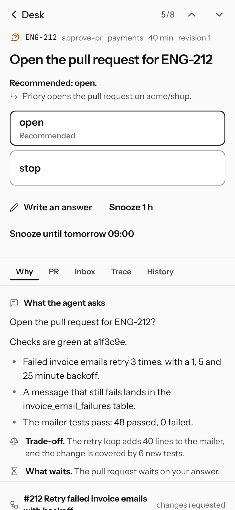

<h1>
  <picture>
    <source media="(prefers-color-scheme: dark)" srcset="design/logo/lockup-dark.svg">
    
  </picture>
</h1>

<!-- tagline: the site shows it as its hero, so its intro skips this paragraph -->
**Build your own agent factory.** Agentic workflows as files in git, run by a daemon on machines you own, with a person on every irreversible step.

Priory runs coding agents, such as Claude Code and Codex, on machines you own. It turns events
into tasks: a labelled GitHub issue, a Linear issue that enters a view, a Slack message, a Sentry
issue or another webhook, a schedule, or a request you type. It then carries each task
through a workflow you wrote, usually to a pull request that a person reviews and merges.

Priory is a Rust program with two long-running processes. The intake polls GitHub, Linear, Slack
and your schedules. The daemon turns what the intake finds, and what webhooks deliver, into tasks,
and runs one agent per task in its own tmux session and git worktree. The daemon also serves a web
view that works on a phone, where you answer what the agents ask. A Herdr adapter and a browser
extension for GitHub's pull request page show the same asks, and
[starter factories](docs/starting-from-a-starter.md) give you a workflow to begin from.

## The problem it solves

Running one coding agent is easy. Keeping several of them moving while nobody watches is not. An
agent waits on CI, on a review or on a person's answer. It crashes, fills the disk or runs the
machine out of memory. A question it asks in its own terminal goes unseen.

Priory handles that work in deterministic code, not in a coordinator agent that spends tokens on
every poll:

- An agent that waits holds no process. It names what it waits for, such as a pull request's
  checks, and goes to sleep. The daemon resumes its session when that event arrives.
- Every question an agent asks lands on one list, the desk, with options and a recommendation.
  You answer it from the command line, or a [trigger](docs/concepts.md) hands its tasks'
  questions to a lead agent and keeps only the irreversible ones for you. A
  [Claude Code plugin](docs/adapters/claude-plugin.md) brings the desk into your own session.
- Every workflow step declares who decides it (a model, a person or code) and what it changes. So
  `priory check` can refuse a workflow before it runs, for example one that pushes code with no
  person's approval. `priory check --explain` lists what a person approves before each
  irreversible step.
- `priory check --repo PATH` scores what an unattended agent needs from a repository, such as one
  test command and required checks on the default branch, and prints how to fix each gap.
- A step can refuse an agent's `passed` until the project's gate, such as its tests, passed at the
  branch's head. `priory check --explain` lists the outcomes the daemon verifies.
- A workflow can be a runbook of human steps only, where an answer runs a step's command once.
  The desk also holds your own to-dos, ranked after the asks.
- Every step's outcome, tokens and time are recorded, so you can measure a workflow and its cost.
- Spend caps per task, day or week stop a factory that overspends: past a cap, a task waits for
  you to raise the cap or stop it. See [docs/daemon/spend.md](docs/daemon/spend.md).
- Agents share [skills and memories](docs/daemon/skills.md) kept in git, in the factory, a kit
  repository or a memories repository. One that names the files it is about joins a Claude Code
  run's context when the run reads, edits or creates such a file. An agent proposes a memory, or a nightly dream
  proposes memories from the day's tasks, and a person accepts each one.
- [Scorers](docs/daemon/score.md) grade finished runs, and a step can use one as a gate that
  refuses a result. A judge scorer counts only once it agrees with a person's labels, and a
  [benchmark](docs/daemon/bench.md) replays past tasks to compare a change to the factory.
- A trigger can run a [`pre` script](docs/intake/pre.md) that drops or changes its task requests,
  run its tasks [staged](docs/daemon/tools.md#staged-tasks) as a trial in which no irreversible
  step runs, and let
  the daemon [answer](docs/daemon/waits.md#answered-by-auto) a reversible ask when the agent
  states enough confidence.
- A [debate step](docs/daemon/debates.md) has two agents answer one question in turns, and ends
  with their verdict or your pick. A [decision model](docs/daemon/decisions.md), once measured
  against your labels, settles review feedback that asks the agent for nothing.
- A run can [consult an investigator](docs/daemon/tools.md#consulting-an-investigator), a
  read-only agent with its own MCP servers, such as an error tracker's, and get its report without
  ever holding those servers.
- A run's result can carry [evidence](docs/daemon/evidence.md), such as a screenshot or a
  recording, so you see the change work before you read the diff.
- The queue holds new starts while too many pull requests wait for your
  [review](docs/daemon/runs.md#review-limit), lets a blocker task
  [stop a lower band's run](docs/daemon/room.md#urgent-wakes) at the end of its turn, and asks you
  when a fix [fails the same checks](docs/daemon/waits.md#a-fix-that-fails-the-same-way) twice.
- A repository's [setup, resume and teardown recipes](docs/daemon/runs.md#recipes) prepare and
  clean up its worktrees, so no run has to find out how to install and build it.

## The web view

The daemon's HTTP server, set by `[serve]` in `factory.toml`, serves a web view: the desk, asks,
the inbox, tasks, runs, the queue, flows and costs. By default it listens on this machine only. Reaching it
from a phone needs a tunnel, and which one is the owner's call:
[How to use the web view](docs/using-the-web-view.md) has the steps. These screenshots show
`priory serve` on a demo factory. [views.md](docs/reference/views.md#what-each-panel-shows) shows
every panel, and [DESIGN.md](DESIGN.md) holds the design rules.


On a phone, an ask opens as a page with its recommendation and options. Scrolling keeps an answer
bar at the bottom.



Flows draw each workflow and mark who decides each edge and which step is irreversible. Costs show
spend, merges and your attention.


## Get started

Install the latest release's binary to `~/.local/bin` with the script, or build it with Nix:

```sh
curl -fsSL https://raw.githubusercontent.com/maxence-lefebvre/priory/main/install.sh | sh
```

```sh
nix profile install github:maxence-lefebvre/priory
```

[How to install Priory](docs/installing-a-release.md) says what the script checks and how to add
Priory to a flake. To build from a clone instead, with the Rust toolchain that
`rust-toolchain.toml` pins:

```sh
git clone https://github.com/maxence-lefebvre/priory
cd priory
cargo install --path crates/priory
```

`cargo install` puts `priory` in `~/.cargo/bin`. Then follow
[GETTING_STARTED.md](GETTING_STARTED.md). It takes you from this build to a factory of
your own, a first task, and a first ask answered in the web view on `127.0.0.1`. To begin from a
ready-made factory instead, see
[How to start from a starter factory](docs/starting-from-a-starter.md).

## Status

Priory is in early development. The milestones come from [docs/prd.md](docs/prd.md#milestones).
Each one names a test that says when it is done.

| Milestone | Scope | Features | Done-when test |
| --------- | ----- | -------- | -------------- |
| M0 | One machine, tmux, Claude Code, CLI and GitHub intake, inbox, workflows, waits, asks, results, health | Built | Each part is covered by an automated test with a stand-in agent |
| M1 | Linear, Slack replies, schedules, queue order, holds, revive, lanes, bands, memory gate, agents slice, retiring tasks, traces, reports, nudges, repair, Codex | Built | The one-week run on the author's factory is for the author to confirm |
| M2 | Web view, webhooks, terminal attach, command answers, OpenTelemetry export, search | Built | Still to be run by a person: one working day of asks answered from a phone only |
| M3 | Several machines, state adapters, shared skills and memories | Built, except a remote task's detail page (R8.5) | The one-hour cut was run once on 2026-11-21 and no task ran twice. The procedure is in [adding-a-second-machine.md](docs/adding-a-second-machine.md) |
| M4 | Risk estimate, scorers and benchmarks | Built | Still to be run by a person: a configuration change compared on replayed tasks before it merges. The procedure is in [bench.md](docs/daemon/bench.md#before-a-change-merges) |

## Documentation

[maxence-lefebvre.github.io/priory](https://maxence-lefebvre.github.io/priory/) holds these pages
as a website, with search, built from `main`.

- Tutorial: [GETTING_STARTED.md](GETTING_STARTED.md), from a build to a first answered ask.
- How-to guides, one task each:
  [start from a starter](docs/starting-from-a-starter.md),
  [install Priory](docs/installing-a-release.md),
  [use the web view, on a phone too](docs/using-the-web-view.md),
  [install the Herdr adapter](docs/installing-the-herdr-adapter.md),
  [run Priory as services](docs/running-as-services.md),
  [test a factory with fake agents](docs/testing-a-factory.md),
  [add a second machine](docs/adding-a-second-machine.md),
  [share build caches](docs/sharing-build-caches.md),
  [send traces to an OpenTelemetry backend](docs/sending-traces-to-opentelemetry.md),
  [send metrics to an OpenTelemetry backend](docs/sending-metrics.md),
  [evaluate a prompt change](docs/evaluating-a-prompt.md),
  [set up a nightly dream](docs/setting-up-a-nightly-dream.md),
  [filter and enrich events with a script](docs/filtering-and-enriching-events.md) and
  [use Priory from your own session](docs/using-priory-from-your-own-session.md).
- Reference: [docs/reference/](docs/reference/README.md) lists every
  [command](docs/reference/cli.md), every key of the factory's files, every HTTP endpoint and every
  intake message, with their JSON Schemas. [docs/trace-schema.md](docs/trace-schema.md) holds the
  format of trace records.
- How it works: [docs/concepts.md](docs/concepts.md) explains the terms.
  [Priory and other agent factories](docs/priory-and-other-factories.md) compares Priory with
  twenty similar products and says what Priory lacks.
  [docs/daemon/](docs/daemon/README.md) explains how the daemon runs tasks, and
  [docs/intake/](docs/intake/README.md) how each source becomes events, one file per topic.
- Adapters: [docs/adapters/herdr.md](docs/adapters/herdr.md), Priory's panels as Herdr mods.
  [docs/adapters/github.md](docs/adapters/github.md), Priory on a pull request's page: its
  task, its asks and a review guide.
  [docs/adapters/claude-plugin.md](docs/adapters/claude-plugin.md), the Claude Code plugin that lets
  your own session read the desk, ask you a question and add a task.
- Project: [docs/prd.md](docs/prd.md) says what Priory does and in which milestone.
  [CONTRIBUTING.md](CONTRIBUTING.md) says how to change Priory, and [DESIGN.md](DESIGN.md) holds
  the design system of the web view.

## License

MIT. See [LICENSE](LICENSE).
