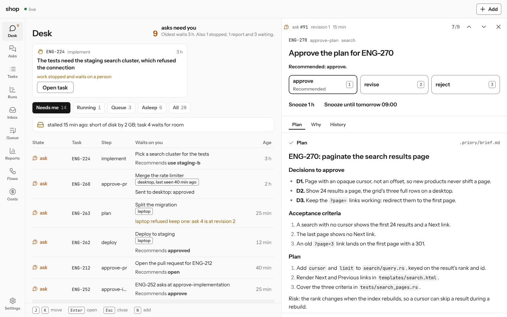

# Delivering outside answers

An ask from a session Priory did not start (see [tools.md](../reference/tools.md#asks-from-outside-priory))
waits on a person like any ask. Its answer has no task to wake. Instead, the daemon hands it to a
command that the factory names, which brings it to the session that asked. Core knows nothing of
that session's terminal: the command does.

```toml
[asks]
deliver = "adapters/herdr/deliver"
```

The path is relative to the factory folder. Without `deliver`, an answer is only stored.

## When the command runs

`priory answer` or `priory dismiss` on an outside ask stores a delivery in the same transaction as
the answer, when the factory has `deliver` and the ask has a `session`. The daemon starts each due
delivery at its next tick, in the factory folder:

```sh
deliver ASK REVISION SESSION answered ANSWER
deliver ASK REVISION SESSION dismissed ""
```

Each value is one argument, never parsed by a shell, so an answer with quotes, `$(...)` or
newlines reaches the command as the person wrote it. The command's exit code says whether the
session got the text: 0 is delivered, anything else is a failed try.

## Retries and failure

A delivery moves through these states, which `priory asks --json` and `/api/asks` show in
`delivery`:

| State       | Meaning                                                            |
| ----------- | ------------------------------------------------------------------ |
| `queued`    | Waits for its due time                                             |
| `running`   | Its command runs                                                   |
| `delivered` | Its command exited 0                                               |
| `failed`    | Its last try failed. The desk shows it as a `delivery` item        |

A failed try is tried again 1, 2, 4, then 8 seconds later, so 5 tries in about 15 seconds. A try
that runs past 3 minutes is killed and counts as failed. The fifth failed try fails the delivery,
with its exit status and the tail of its output as `error`. The desk shows a failed delivery until
the asker asks the same ID again, or a person clears or retries it.

`priory deliver ASK --retry` queues the failed latest delivery of `ASK` again, with 5 fresh tries.
It refuses a delivery of an older revision than the ask has now, since that answer is stale:
answer the ask again instead. `priory deliver ASK --clear` takes it off the desk and keeps it `failed`; `delivery.cleared` holds
when. Both go to the daemon over its socket, and are refused with
`the delivery of <ask> has not failed` while it is queued, running or delivered.

## Daemon restarts

The daemon records each command's process as it starts it, and a small `sh` wrapper writes the
command's exit code to a file in `PRIORY_HOME/deliveries/`. A daemon that starts while a command
from before its restart still runs waits for that command, up to the same 3 minutes from its start,
and then reads its exit code. So a restart never runs a try twice. A command that left no exit
code, such as one a reboot killed, may have reached the session, so its delivery fails at once
instead of trying again.

A delivery keeps the session the ask had when it was answered. Asking again with another session
does not move an answer already stored.

Known limits:

- A daemon that stops between marking a try `running` and recording its process fails that
  delivery on restart, even when its command never started or delivered.
- A command that delivers, then exits with another code or runs past its timeout, is tried again.
  Exit 0 is the only proof of delivery that Priory reads.
- An answer to an old revision is still delivered, with that revision, after the ask changed.
- `priory check` refuses a `deliver` that is not an executable file in the factory folder, but it
  does not run the file. A script with a syntax error still fails each try.

## The plan an ask approves

A step that approves a plan, such as `approve-plan` in a groom workflow, asks after an agent wrote
that plan to a file in the task's worktree: `.priory/plan.md`, or `.priory/brief.md` for a brief.
`priory task ID --json` and `/api/tasks/ID` read that file on each call and serve it as
`plan_file` (see [serve.md](../reference/serve.md)). The web view and the Herdr Asks panel show it
in the ask's Plan section, as Markdown in the web view and as plain text in Herdr. For an open step
ask, Plan comes before Why, so the decisions read before the options.



Priory reads only the task's own worktree. A file whose real path leaves it, such as a symlink to
another folder, is skipped. Past 64 KB the text is cut, and the section says where to read the
rest. With no file, Plan falls back to the `plan` step's result, as before.

Known limits:

- A task on another runner keeps its worktree on that machine, so this runner shows the fallback.
- A worktree removed to free disk takes its plan file with it.
