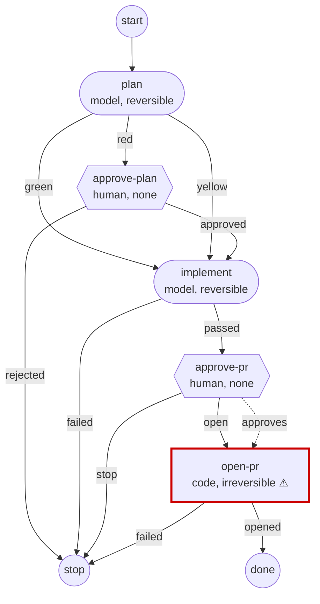

# Priory: product requirements

Status: draft, 2026-11-17.

## Summary

Priory runs a software factory on machines you own. A factory is a directory of files: agents,
triggers, runners, workflows, views and skills. Priory reads it and turns events into tasks. An event
can be an issue, a pull request change, a schedule or a person's request. Priory places each task's
agent on a machine with room and carries the task through its workflow, usually to a pull request
that a person merges.

An agent that waits on CI, a review or an answer holds no process. It sleeps and wakes when the
event it named arrives. Every workflow step declares who decides it and what it changes, so a
factory can be linted before it runs and measured after.

With Priory you can leave coding work running unattended, answer its questions in one place, and
come back to pull requests you can review.

## Why

Fleet, the author's private factory, runs coding agents every day on one desktop. It is about 24,000
lines of Rust (2026-11-17). It taught four things:

1. Most of the work goes into keeping agents moving without a person watching: waits, wakes,
   stalls, crashes, full disks and memory pressure.
2. A coordinator agent that polls spends tokens on every tick. A deterministic daemon that starts
   short agent sessions for judgement is cheaper and easier to predict.
3. People need one place to answer agents. A question asked in an agent's own terminal blocks the
   agent and goes unseen.
4. Without typed steps, nobody can say how risky a workflow is or whether a change made it better.

Other tools cover parts of this. From their public pages on 2026-11-17:

- [Warp Factories](https://www.warp.dev/factories) define the factory as code, with scorers and
  benchmarks. Runs execute in Warp's cloud or the customer's VPC and are priced per run.
- [Gas City](https://github.com/gastownhall/gascity) is open source. It runs a work graph of
  formulas and beads on many runtimes.
- [herdr-bowtie](https://github.com/flupke/herdr-bowtie) and
  [herdr-bus](https://github.com/flupke/herdr-bus) run tasks across machines with offline
  messaging. They are built around one structure of leads and chiefs of staff, on Herdr and jj.

Priory aims at the gap: open source, on a few machines you own, factory as code, agents that sleep
without a process, and workflows you can measure.

## Users

The primary user is an engineer who runs coding agents on one to three machines, such as a
desktop, an always-on box and a laptop. They work alone or in a small team. They want agents to
keep working while they are away, and they want to answer agents from any device.

Out of scope for now: a hosted service, Kubernetes, and one factory shared by dozens of people.

## Principles

1. The factory is files in a repository. Changing it is a pull request.
2. Code decides what code can decide. Models judge; they do not schedule.
3. A waiting agent holds no process.
4. Every step declares its decider and its effect. An irreversible step runs only after a person
   approved that step, unless the factory marks it autonomous with a reason.
5. Offline is normal. A machine that goes away and comes back loses nothing.
6. Code gets a swappable adapter boundary only in the milestone that brings its second adapter.
7. Anything a person must answer or unblock goes to the desk, never only to a terminal.

## Concepts

The Warp column comes from Warp's public page and is blank where that page says nothing.

| Concept    | Meaning                                                                   | Warp         | Fleet            |
| ---------- | ------------------------------------------------------------------------- | ------------ | ---------------- |
| Factory    | The directory of files that defines everything below                     | factory      | skills and nix   |
| Agent      | Who runs: harness, model, effort, MCP servers, skills, prompt, session   | agent        | worker, handler  |
| Runner     | A machine that runs agents, named by its Tailscale hostname              | runner       | the host         |
| Trigger    | An event source, a filter and the workflow its events start              | automation   | watch            |
| Workflow   | The typed steps a task goes through                                       |              | brief and rules  |
| Task       | One unit of work, from intake to an outcome                               |              | pick             |
| Run        | One agent process working on a task, from start to sleep or exit         | run          | worker launch    |
| Session    | An agent's conversation, which survives the runs that resume it          |              | session          |
| Event      | Something that happened: a poll result, a webhook, a schedule, an answer | delivery     | event            |
| Intake     | The process that polls sources, matches triggers and publishes events     |              | watch-poll       |
| Inbox      | The durable list of events, each routed to the task it concerns          |              | inbox            |
| Desk       | What waits on a person: asks, blocked tasks and reports                   |              | asks panel       |
| Wait       | The conditions an agent names before it sleeps                            |              | `retire --on`    |
| Ask        | A question to a person, with options, a recommendation and a trade-off    | review gate  | ask              |
| Result     | The immutable record of a run's outcome and its evidence                  |              | result           |
| Trace      | One record per step: decider, effect, outcome, tokens and time; exported as OpenTelemetry spans | |                  |
| View       | A layout of panels that shows the factory and acts on it                  |              | Herdr mods       |
| Queue      | The tasks waiting for a run, in band order, then a person's order, then age |              | queue            |
| Lane       | A `<team>/<theme>` label that groups tasks in views and reports           |              | lane             |

## Configuration

```
factory.toml                 # or factory.yaml
agents/<name>/agent.md
triggers/<name>.toml         # or .yaml
workflows/<name>.toml        # or .yaml
runners/<tailscale-hostname>.toml
views/<name>.toml
lanes.toml                   # or lanes.yaml
prices.toml                  # or prices.yaml: dollars per million tokens, by model
skills/<name>/SKILL.md
webhooks/  scorers/  benchmarks/
```

Markdown files carry frontmatter fenced by `---` for YAML or `+++` for TOML. Standalone files pick
their format by extension. Both formats share one schema, defined in code and published as JSON
Schema. YAML is parsed as YAML 1.2, so `on` and `no` stay strings. Durations and sizes are strings,
such as `"15m"` and `"4GB"`.

`agents/implementer/agent.md`:

```markdown
+++
description = "Implements one task and opens its pull request."
harness = "claude-code"
model = "sonnet"
runner = "any"
session = "per-task"         # or "shared": one conversation across tasks, such as a lead
memory = "6GB"               # what a runner must have free to admit a run
mcpServers = ["github"]
# defaultMode is the run's mode: manual when unset; bypassPermissions is refused
permissions = { defaultMode = "auto", allow = ["Bash(cargo test:*)"], deny = ["Bash(git push:*)"] }
+++
# Implementation
Read the issue and acceptance criteria, make the smallest correct change, test it.
```

`runners/xps13.toml`, named by the machine's Tailscale hostname. Capacity is measured live, so the
file holds the platform and, optionally, the share of the machine its agents may take together
(R4.10):

```toml
platform = { os = "linux" }
agents = { cpu = "50%", memory = "60%" }   # a laptop in use; omit for the 90 % default
```

A trigger names one event source, its filter and the workflow it starts. The workflow names the
agent of each step. `key` says which events are the same work: a factory holds at most one active
task per key. Priory scopes each key to its source, and a GitHub key to its repository, so issue 42
of two repositories stays two tasks.

`triggers/linear-agent-ready.toml`:

```toml
source = "linear.view"
view = "agent-ready"         # a saved Linear view
on = "issue.entered"         # an issue entered the view
workflow = "implement"
key = "issue.id"
band = "today"
lane = "3D/mobile"           # optional: otherwise lanes.toml derives it
```

`triggers/agent-label.toml`:

```toml
source = "github"
repo = "owner/name"
on = "issues.labeled"           # or "issues.opened", "pull_request.labeled", "pull_request.opened"
filter = { label = "agent" }    # only with a `*.labeled` event
workflow = "implement"
key = "issue.number"            # "pull_request.number" for a pull_request event
backfill = false                # true: also start tasks for the events of the first poll
```

`triggers/support-day.toml`:

```toml
source = "schedule"
repo = "owner/name"             # the repository its runs work in
at = "09:00"                    # local time of day
days = ["mon", "tue", "wed", "thu", "fri"]  # optional: every day when unset
every = "1h"                    # optional: fire again every hour after `at`, the same day
until = "18:00"                 # optional: a time of day or a duration after `at`, such as "9h"
timezone = "Europe/Paris"       # optional: the machine's zone when unset
key = "support-day"             # optional: every firing names the same task
prompt = "Sweep the support queue."  # what a firing tells the asleep task it wakes
workflow = "support"
```

### Lanes

A lane groups related work, such as `3D/mobile`, so views and reports show it together. A trigger
can set a task's lane. Otherwise `lanes.toml` derives it, and the first matching rule wins:

```toml
fallback = "{team}/misc"     # {team} is the issue's team; "none/misc" without one; this is the default

[[rules]]
key = "3D-600"
lane = "3D/mobile"

[[rules]]
branch = "*desktop*"         # a glob on the task's branch
lane = "FND/desktop"
```

A rule matches on the task's key, its issue's team or project, or its branch. A rule that names
several fields needs all of them, and a rule must name at least one. A `*` in a branch pattern
matches any run of characters. `priory check` rejects a lane that is not `<team>/<theme>`, a rule
with no field to match on, and an unknown rule field, with its line.

The daemon sets a task's lane when it creates the task, from the request's lane, else the first
matching rule, else the fallback, which is `{team}/misc` when `lanes.toml` is absent or sets none, so every task has a lane. The team and project come from the source event when it carries
them, and `{team}` becomes `none` without a team. No branch exists yet, so a branch rule cannot match
then. When the task's first run creates its branch, a lane that was derived is derived again with the
branch, so a branch rule can then win. A lane the request set never changes, and neither does a
derived lane once the task has a branch: editing `lanes.toml` later does not move a task already
running. `priory tasks --lane L` lists one lane.

### Workflows

A workflow starts at `start`. Reaching `done` ends the task as done, and reaching `stop` ends it as
dropped. Each step has one decider, one effect and one way to produce its outcome:

| `decides` | What runs                                  | Its outcome comes from                    |
| --------- | ------------------------------------------ | ----------------------------------------- |
| `model`   | `agent`, with the step's `prompt`          | the `outcome` field of the run's `result` |
| `human`   | an ask with the step's `options`           | the option the person picks               |
| `code`    | a built-in `action`, such as `open-pr`     | the action's status                       |

`next` maps each outcome to a step id, `done` or `stop`. `priory check` rejects an unknown step, an
outcome with no `next`, a step no path reaches, and an irreversible step without the approval the
next section describes.

`workflows/implement.toml`:

```toml
start = "plan"

[[steps]]
id = "plan"
decides = "model"
agent = "implementer"
prompt = "Plan the change. Grade it red, yellow or green."
effect = "reversible"
next = { red = "approve-plan", yellow = "implement", green = "implement" }

[[steps]]
id = "approve-plan"
decides = "human"
effect = "none"
options = ["approved", "rejected"]
next = { approved = "implement", rejected = "stop" }

[[steps]]
id = "implement"
decides = "model"
agent = "implementer"
prompt = "Implement the plan and run the tests."
effect = "reversible"
next = { passed = "approve-pr", failed = "stop" }

[[steps]]
id = "approve-pr"
decides = "human"
effect = "none"
approves = ["open-pr"]
options = ["open", "stop"]
next = { open = "open-pr", stop = "stop" }

[[steps]]
id = "open-pr"
decides = "code"
action = "open-pr"
effect = "irreversible"
next = { opened = "done", failed = "stop" }
```

### Drawing a workflow

`priory draw [DIR] <workflow>` prints a Mermaid flowchart of a workflow, after the same checks as
`priory check`. The notation shows the decider and the effect of every step:

| Part                  | Drawn as                                                  |
| --------------------- | --------------------------------------------------------- |
| `model` step          | a stadium, `([...])`                                      |
| `human` step          | a hexagon, `{{...}}`                                      |
| `code` step           | a rectangle, `[...]`                                      |
| Effect                | the second line of the label, after the decider           |
| `irreversible` effect | a red border and a `⚠` after the effect                   |
| Outcome               | an arrow from the step to its target, labelled            |
| `done` and `stop`     | circles                                                   |
| `start`               | a circle with an arrow to the workflow's `start` step     |
| `approves`            | a dotted arrow, labelled `approves`, to the approved step |

Steps get the ids `n0`, `n1` and so on, in file order, so any step id is safe. The example above
draws as:



### Approval of irreversible steps

An irreversible step needs either a human step that lists it in `approves` on every path that
reaches it, or `autonomous = "<reason>"` on the step itself. An approval covers one task and the
commit it was given for. An answer grants the approval when its `next` leads toward the approved
step. If the task's commit changes before the irreversible step runs, Priory
asks again.

## Requirements

Milestones are defined below. Each requirement names the milestone that delivers it.

### R1. Configuration

- R1.1 `priory check` validates a factory in either format and reports errors with file and line.
  A rule error, such as an unreachable step, names the line of its step, trigger field or `start`. M0
- R1.2 `priory check` enforces the workflow rules and the approval rule above. M0
- R1.3 `priory draw` renders a workflow in the decider and effect notation. M1

### R2. Intake: events and triggers

The intake runs as its own process. It polls the sources, loads `triggers/`, and publishes on one
herdr-bus output, `factory.intake`: every source event as a CloudEvents message of its own type,
such as `github.issues.labeled`, and one `factory.task.requested` message for each event a trigger
matches. That message names the workflow, key, band, lane and source event. The Priory daemon reads
the output as one consumer and acks each message after its own transaction commits. Another
factory, such as herdr-bowtie, can read the same output as another consumer.

- R2.1 Run the intake as its own process, publishing to `factory.intake` as above. M0
- R2.2 Accept tasks from the CLI, and GitHub events: issues, pull requests, check runs, reviews and
  merges. M0
- R2.3 Deliver each event at least once and drop duplicates by event id. M0
- R2.4 Trigger on Linear saved views (an issue enters or leaves) and on Linear issues and comments.
  Poll the Slack threads that waits name. M1
- R2.5 Trigger on schedules: a time of day, weekdays, an optional repeat until an end, and a
  timezone. Each firing publishes one task request, once, and a restart fires only the latest
  missed firing. Without a fixed `key`, each firing starts its own task. With one, a firing creates
  the task when none is active, wakes it with the trigger's `prompt` when it is asleep, even when
  its wait does not match and while its ask stays open, and is coalesced when it is in any other
  state, so firings never stack. A recurring wake is a schedule trigger, not an agent's own loop. M1
- R2.6 Accept signed webhooks and check the signature before any trigger sees the payload. M2

### R3. Inbox

Every event lands in the inbox before anything acts on it. The daemon reads the inbox one entry at a
time and finds the task the event concerns. A task registers what it owns: the key of the trigger
that created it, its branch, its pull request, its asks and its waits. An event concerns the task
that owns a resource it names, such as a check run on the task's pull request or an answer to its
ask.

Only a `factory.task.requested` message creates a task. Any other event that concerns no active task
is recorded with no action. A task is active in any state except done,
failed and dropped. An event for a failed task stays on it, for its repair.

The daemon then reconciles the task with the event:

| The task                                  | The daemon                                                      |
| ----------------------------------------- | --------------------------------------------------------------- |
| None active, and the message is `factory.task.requested` | creates a task and starts its workflow   |
| Queued, held, ready or blocked            | keeps the event and delivers it to the task's first run         |
| Running                                   | sends the event to the agent as a message, through the outbox   |
| Asleep, and the event matches its wait    | wakes it: makes it ready, then resumes its session in its worktree with the event |
| Retired, and the event matches its wait   | resurrects it: makes it ready, recreates the worktree from its branch, then resumes its session |
| Asleep or retired, and no wait matches    | keeps the event and delivers it with the next wake              |

A woken or resurrected task goes through the runner's room check like any other, and its events wait
until its run starts.

- R3.1 Store every event in the inbox before acting on it, and mark each entry with the task it
  concerns and what the daemon did. `priory inbox` lists them. M0
- R3.2 Create, deliver, message and wake, as the table says. M0
- R3.3 Retire an asleep task when disk runs short, only if its branch holds every change: no
  uncommitted or untracked files. Keep its branch and its session. Resurrect a retired task as the
  table says. M1

### R4. Tasks and scheduling

- R4.1 A task moves through queued, held, ready, running, asleep, blocked, done, failed and dropped. An
  asleep task has no agent process and keeps its worktree. M0
- R4.2 A retired task has no process and no worktree, and keeps its branch and its session. M1
- R4.3 A runner admits a run only when its live free memory, disk and CPU leave room for the agent's
  declared needs. M0
- R4.4 The queue starts ready tasks in band order, then in the order a person set inside the band,
  then oldest first. The bands default to `blocker`, `now`, `today` and `later`, and `factory.toml`
  can rename them. A trigger or workflow sets a task's default band. A higher band only starts
  earlier: it never skips the room check. M1
- R4.5 A person can move a task to another band or position, from the CLI or a view. M1
- R4.6 A task can be held with a reason, by a person or until a time, another task's end, a pull
  request's merge, or its issue's last open blocker. A hold on a pull request also says what happens
  if the pull request closes without a merge: release the task, drop it, or ask. M1
- R4.7 A person can revive a failed or dropped task. The revived task gets a new generation, and the
  asks and waits of the old one are withdrawn, so a late answer cannot reach it. M1
- R4.8 Every task has a lane, set by its trigger or derived from `lanes.toml`. M1
- R4.9 Heavy commands inside a run queue behind one memory gate:
  `priory memory acquire --gb N -- <command>`. M1
- R4.10 On a systemd host, each run starts in its own scope inside one user slice,
  `priory-agents.slice`, through `systemd-run --user --scope --slice=priory-agents.slice -- <agent>`
  in its tmux pane. The slice caps every agent and everything it runs together, at a share of CPU and
  memory set by the runner's `agents` field (90 % by default). Agents yield CPU to the user's own apps, and past
  their memory share they slow down instead of being killed. A host without systemd relies on the
  room check alone. M1
- R4.11 The daemon runs as a systemd user service. On an always-on machine, user lingering keeps it
  and its agents running with nobody logged in. M0

### R5. Agent runtime

- R5.1 Start a run in its own git worktree, in a tmux session Priory owns, with one harness: Claude
  Code in M0, Codex in M1. M0
- R5.2 tmux owns agent processes. The daemon can restart without stopping them, and it reconnects
  to their sessions when it comes back. A run lost with its tmux server, as in a reboot, resumes its
  session once; a second loss with no result, wait or ask in between blocks the task. M0
- R5.3 A `per-task` session starts with the task and ends with it. A `shared` session carries one
  conversation across tasks. Either way, a waiting session holds no process. M0
- R5.4 Prompts go through a stored outbox and are typed only when the agent is idle. Priory records
  each attempt before it types. After a crash with an attempt and no confirmation, Priory marks the
  prompt uncertain on the desk instead of typing it again. M0
- R5.5 Store each run's harness session id, so a later run resumes the same conversation. M0
- R5.6 Let a person attach to any run's terminal from a view. A view host attaches a tmux client,
  such as `hc run "tmux attach -t <session>"` in a Herdr pane, and tmux stays the owner. M2

### R6. Agent tools: wait, ask, result

Priory serves these as MCP tools.

- R6.1 `wait(on)` puts the agent to sleep until one condition fires. M0 conditions: a pull request merges
  or closes, its checks finish, it gets a review or comment, an ask is answered, a time passes,
  another task ends. M1 adds Linear comments and states, Slack replies, and free disk.
- R6.2 A wait is stored before the agent sleeps. Priory then checks whether the condition already
  holds for events after the agent's last prompt, and wakes it at once if so. A task has at most one
  running run. M0
- R6.3 `ask` records a question with options, a recommendation and a trade-off, then puts the
  agent to sleep. An answer carries the question revision it read, and an answer to a changed
  question is refused. The first answer to a revision stands, and later ones are refused. M0
- R6.4 A hook denies the harness's built-in question tool and points to `ask`. M0
- R6.5 `result` stores an immutable record for the run, with its outcome and evidence. M0
- R6.6 Priory marks a task done when its workflow reaches `done`. For a task with a pull request,
  that also needs the pull request head to match the result's commit, and every required check at
  that head to have finished green. Until then the task is asleep on a wait the daemon registers for
  those checks. Green checks mark it done without starting the agent. A red check wakes the agent
  with the failure. M0
- R6.7 When a turn Priory started ends without `wait`, `ask` or `result`, the stop hook sends one
  nudge. M1
- R6.8 An ask can carry a command that the person's answer runs. The answer is bound to the command,
  its target and the question revision, runs at most once, and reports an uncertain outcome if
  Priory crashes mid-run. Views need authentication first. M2

### R7. Health and housekeeping

- R7.1 Every tick checks each run for an unexpected exit, a timeout and a blocked permission prompt.
  A run that went to sleep through `wait` or `ask`, or ended with a `result`, is not unexpected.
  Each verdict moves the task to blocked or failed and adds a desk item with resume and cancel
  actions. M0
- R7.2 Priory never approves a permission prompt. It denies it, tells the agent why, and adds an
  item on the desk if the task cannot go on without it. What an agent may do without asking comes from
  its `permissions` field. Runs start in Claude's `manual` mode. An agent whose `defaultMode` is
  `auto` lets Claude's auto mode decide its prompts. M0
- R7.3 Remove the worktree of a task that ended only when Priory created it, its branch merged, it
  has no unpushed commits, no uncommitted changes and no untracked files, and no process runs in it.
  Report every other worktree instead. Retiring an active task follows R3.3. M0
- R7.4 A short handler session reads a stalled agent's screen and nudges or restarts it. M1
- R7.5 A failed task gets one repair attempt per run. The repair restarts the agent only on a cause
  it changed or confirmed gone. M1

### R8. Views

- R8.1 The CLI covers every action, the desk included. M0
- R8.2 A view is a layout file in `views/`: a tree of rows, columns and tabs whose leaves are
  panels, in the manner of Herdr's layouts. The user can change every view, including the
  defaults Priory ships. M2
- R8.3 Priory ships panels for the desk, the inbox, the queue, tasks, runs, agent terminals, workflow diagrams and
  reports. A panel reads the factory's state and acts through the same commands as the CLI. M2
- R8.4 Views render in a browser and work on a phone. M2
- R8.5 Any machine of the factory can serve the views and act on the factory's state. M3
- R8.6 A second view host, such as a Herdr layout, renders the same view files as an adapter. M3

### R9. Several machines

- R9.1 A factory spans several runners. Each task is owned by one runner at a time, which places its
  runs. M3
- R9.2 A runner keeps its tasks going while the other machines are offline. Answers given on another
  machine meanwhile are delivered when it reconnects, through the revision check in R6.3. M3
- R9.3 State goes through an event log with cursors, plus requests with a deadline, a take and a
  reply, in the shape herdr-bus uses. In M0 the log is herdr-bus's SQLite file and the task state is
  Priory's own. The daemon acks a message only after its state change commits, and drops a
  redelivered message by its event id, so each event changes state exactly once. One store for both
  waits for the adapters of R9.4. M0
- R9.4 Herdr-bus and Postgres adapters carry the log between machines, and a factory can switch
  between them. One contract test suite runs against every adapter. M3

### R10. Measurement

- R10.1 Every step appends a `factory.step.ended` record to the log, and later judgements append
  `factory.step.labeled`, as `docs/trace-schema.md` defines. Reports read these records, so they need
  no tracing backend. M1
- R10.2 An exporter turns the records into OpenTelemetry spans over OTLP: a task is a trace, and
  each run and step is a span. Attributes follow OpenTelemetry's GenAI conventions where one exists.
  Runs set the harness's own telemetry, such as Claude Code's OpenTelemetry export, with the task and
  run ids, so both line up in one backend. M2
- R10.3 Reports give per-step outcome counts and rates. A rate's denominator is the runs that reached
  the step, and the report shows it. M1
- R10.4 Cost per task, from token counts and a price table in the factory. M1
- R10.5 Every report and view can group by lane. M1
- R10.6 Estimate the chance that a wrong step outcome reaches an irreversible step. Its labels
  (rejected approval, red CI after merge, revert), estimator and assumptions are specified before it
  ships. M4
- R10.7 Scorers grade finished runs. Benchmarks replay past tasks under another model or
  configuration. M4

### R11. Sharing between machines

- R11.1 Skills, instructions and memories live in git and sync to every runner. M3
- R11.2 Build caches such as sccache or a Nix cache belong to the runner's environment. Priory
  documents them and does not run them.

## Architecture

- One thread owns the state. It takes one input at a time and returns effects. Effects run
  elsewhere and come back as inputs. A state change and its history event commit in one
  transaction.
- Prompts and slow effects are stored, so a daemon restart resumes them where they stood.
- Agents outlive the daemon. Their MCP tools reach it through a stdio bridge on a local socket.
- The intake and the daemon are separate processes joined by a herdr-bus output, so another factory
  can consume the intake too.
- Four boundaries: state, agent runtime, event sources and views. Each becomes a swappable adapter
  only in the milestone that brings its second adapter.
- Written in Rust. The first version reuses Fleet's code where it fits.

## Milestones

| Milestone | Scope                                                                                    | Done when                                                                                                            |
| --------- | ---------------------------------------------------------------------------------------- | -------------------------------------------------------------------------------------------------------------------- |
| M0        | One machine, tmux, one harness, CLI and GitHub intake, inbox, workflows, waits, asks, results, health | The example workflow above runs end to end, with the agent asleep on the `approve-pr` ask until it is answered, the task waiting on the pull request's checks, a daemon restart, a duplicate event and a failed run |
| M1        | Linear, schedules, queue order, holds, revive, lanes, bands, memory gate, agents slice, retire and resurrect, traces, reports, nudges, repair, Codex | The author's own factory runs on Priory for one week                                                     |
| M2        | Web view, webhooks, terminal attach, command answers, OpenTelemetry export                                     | One working day of asks answered from a phone only                                                                   |
| M3        | Several machines, state adapters, shared skills and memories                             | A runner is disconnected for an hour while tasks run, then reconnected, with no task run twice and no answer lost    |
| M4        | Risk estimate, scorers and benchmarks                                                    | A configuration change is compared on replayed tasks before it merges                                                |

## Success measures

- Minutes of a person's attention per merged pull request.
- Share of tasks that reach a pull request with no prompt from a person beyond asks.
- Memory held by waiting agents, which should be zero.
- Time to add a machine to a factory.

## License

MIT.

## Non-goals

- A hosted service or billing.
- Kubernetes.
- Merging pull requests by default. A factory can allow it per workflow, with a reason.
- Replacing CI.
- A chat interface.

## Open questions

1. Whether workflow branching stays limited to outcome labels or gains expressions.
2. Whether to support jj workspaces alongside git worktrees.
3. Whether a Windows machine runs agents through WSL, and whether a runner file then needs more than
   `platform`, such as an environment loader like direnv.
4. Whether third-party panels load as plugins, and in which form.

## Risks

- Scope. herdr-bowtie holds about 147,000 lines of Rust and Markdown (2026-11-17). Each milestone
  has a done-when line, and adapter boundaries wait for a second adapter.
- Harness changes. Claude Code's hooks and flags change often, and Priory depends on them.
- Security. Agents run with the user's credentials. Webhook payloads and issue text are untrusted.
  Secrets are resolved at runtime and never stored in the factory.
