# Views

A view is a layout of the web view: a tree of rows, columns and tabs whose leaves are panels. Each
file `views/<name>.toml`, `.yaml` or `.yml` holds one view, named by its file. Priory ships the view
`default`; a factory file of the same name replaces it. The web view lays out the view named
`default`.

Schema: [`config/view.json`](../schemas/config/view.json).

## Keys

| Key | Type | Required | Meaning | Example |
| --- | ---- | -------- | ------- | ------- |
| `layout` | node | yes | The tree's root | `{ tabs = [{ panel = "desk" }] }` |

A node is a table with exactly one of these keys:

| Key | Value | Meaning |
| --- | ----- | ------- |
| `row` | array of nodes | The children side by side |
| `column` | array of nodes | The children one above the other |
| `tabs` | array of nodes | One child at a time, picked from a tab bar or the rail |
| `panel` | panel name | A leaf: one panel |

The panels are `desk`, `asks`, `inbox`, `queue`, `tasks`, `runs`, `terminal`, `workflow`,
`reports` and `costs`.

## What each panel shows

The web view's Desk shows the same desk. It opens on the next thing: the alarm or ask that ranks
first, with why it ranks there. Under the list, Since you looked shows what happened since your last
visit, and opening the Desk records the visit as `priory seen` does. `priory desk` prints the same
events after its list.

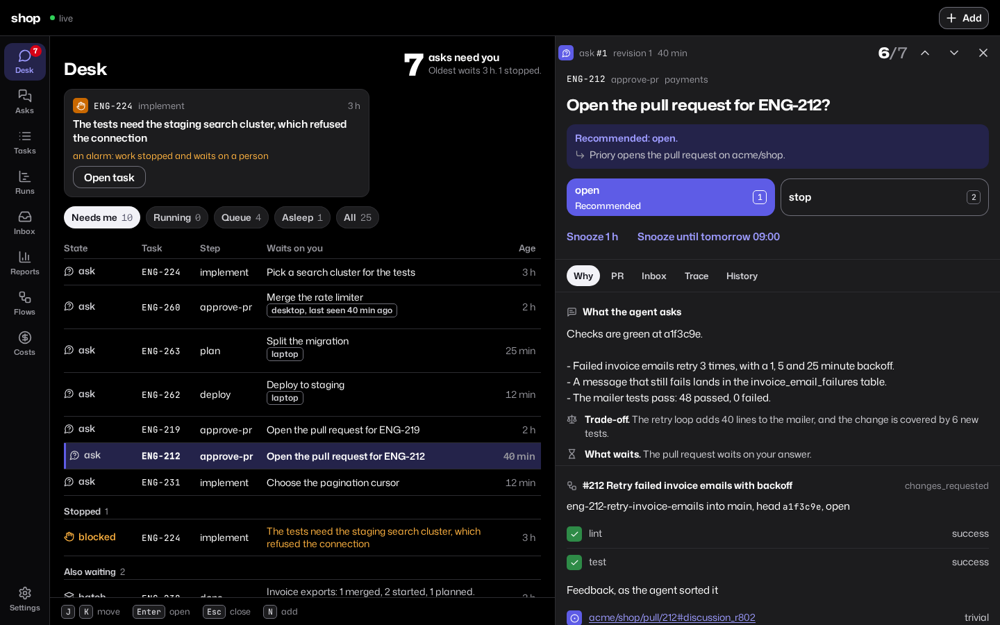

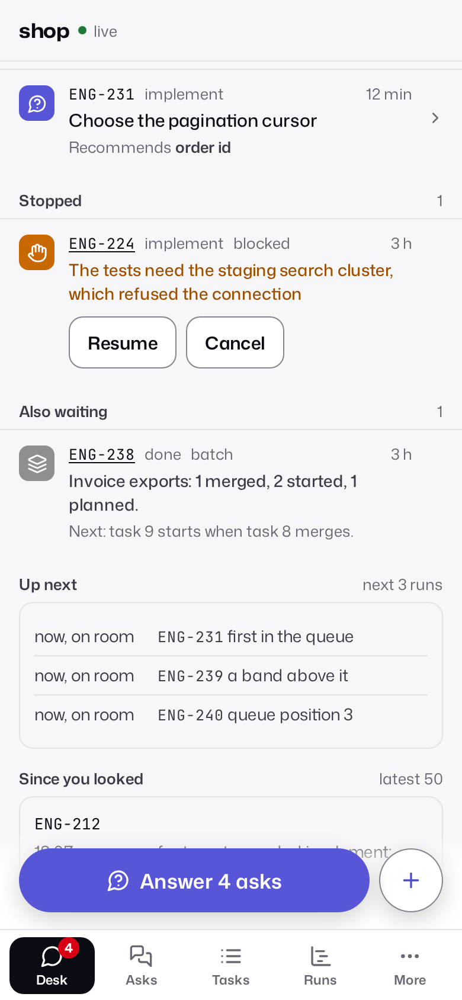

The web view's Asks panel has the saved views Open, Snoozed, Answered and All. A snoozed ask leaves
Open and waits in Snoozed. On a phone, once the options scroll out of view, the answer bar's
"N options" opens a sheet with every option. On a desktop, `S` snoozes the selected ask for 1 h.
A batch's go ask shows the plan as a lane graph, and each entry's menu moves or drops it before you
answer. The desk's batch row opens the batch page, with each entry's state and when it starts.

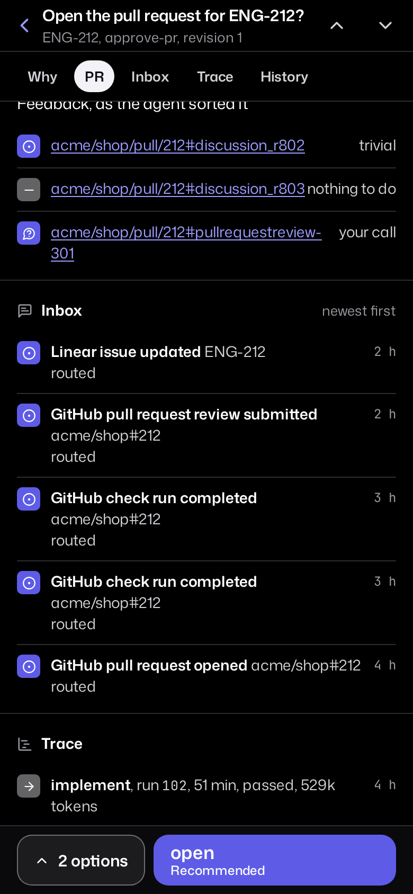

The web view's Tasks panel lists every task, with the saved views Active, Blocked and Ended and
filters by state, lane and workflow; each row opens the task's page, and a batch's entries link to
the batch. The Runs panel lists the runs of the last 7 days with their agent, model, outcome,
duration and tokens, filtered by outcome, agent or step. `priory tasks` and `priory runs` print the
same tasks and runs, and the Herdr Tasks and Runs panels show them too. In a factory of several
runners, both Tasks panels also list the tasks the other runners hold and filter by runner. Such a
task's page stays on its runner, so a tap opens its row in place, with the actions its hold allows:
Resume, Cancel, Release and Say for a `kept` task, Cancel for a `waiting` one. Each goes to its
runner through the log, and the row then shows "Sent to laptop: cancel", or what laptop did with it.


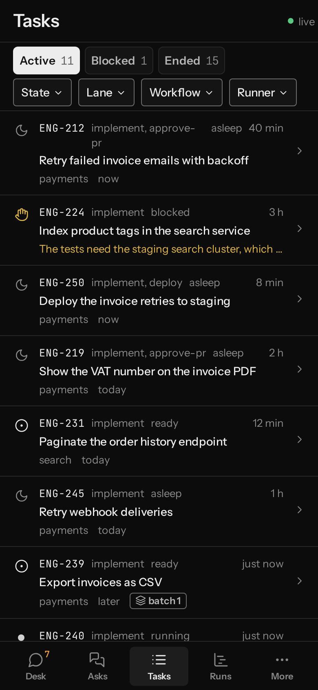

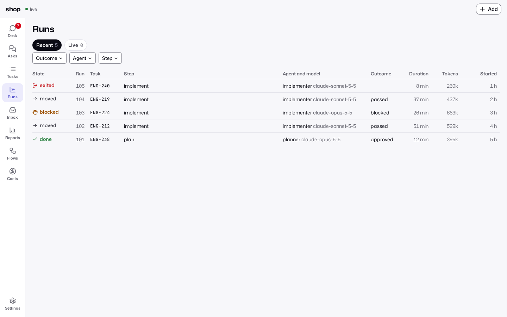

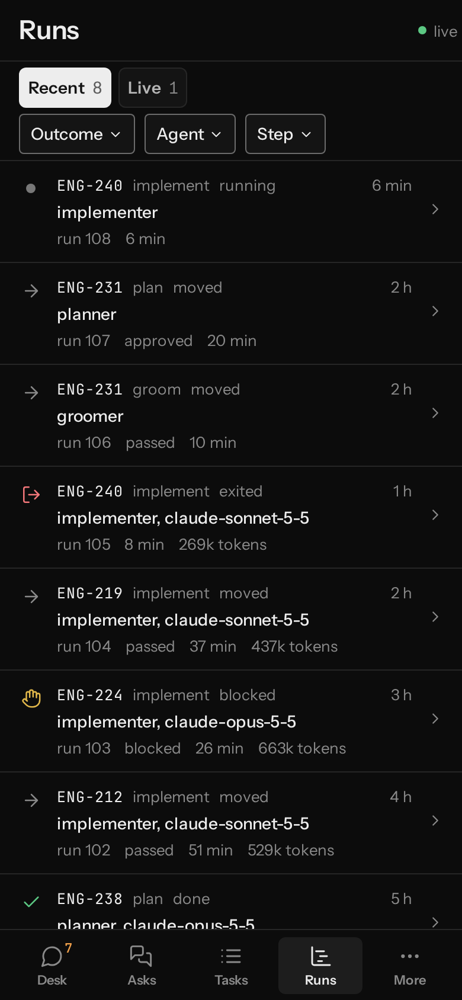

The Inbox panel groups unrouted events by resource and offers actions to subscribe an existing task or request a new one. Above them, it lists the events a sleeping task kept that no agent read, with a Say that tells the task to read them.

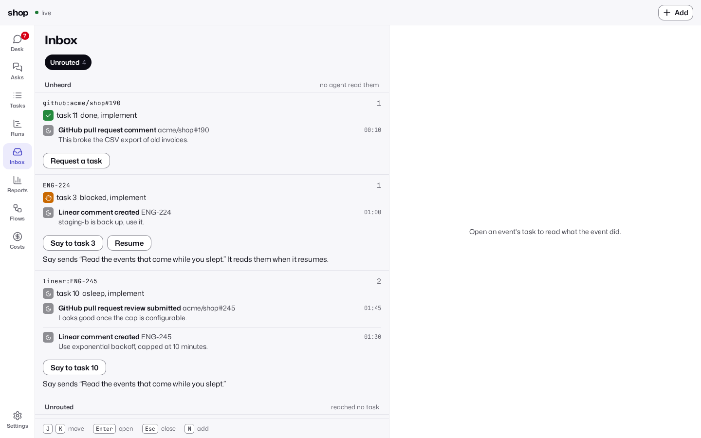

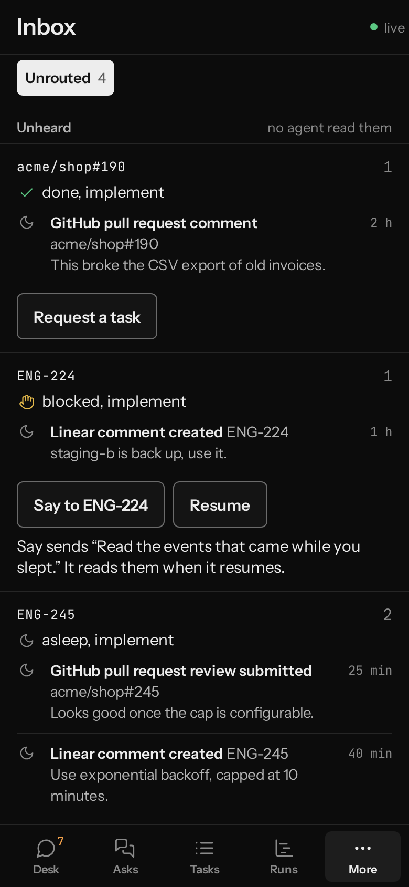

The Queue panel, under More on a phone, shows Up next, then each band's waiting tasks in the order
they start, with why each one waits. Its Move menu moves a task to the top of its band, up or down
one, or to another band, as `priory move` does. `priory queue` prints the same queue.

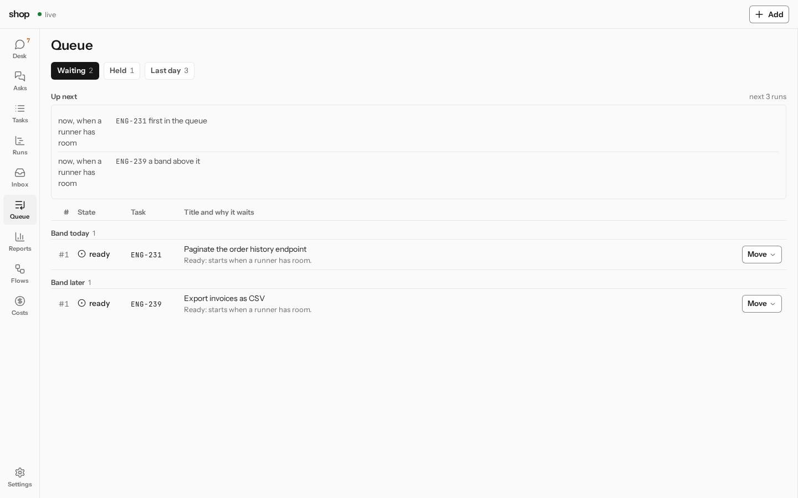

A workflow can write a report for you, such as a morning dossier: `priory report show` prints the
last one, and `priory report list` lists the earlier ones. The web view's Reports panel shows it, and takes its picks and row comments as
`priory report pick` and `priory report comment` do. See [docs/daemon/reports.md](../daemon/reports.md).

The web view's Costs panel shows what the factory spent this week against last week, each day, and
split by workflow, agent, model, machine, repository or lane, as `priory costs` prints it. Beside it,
Attention shows the minutes of your attention per merged pull request, how long asks waited for
you, and where each task's time went, as `priory report attention` prints it. On a phone, both sit
under More. The Herdr Costs panel shows the same. See [docs/daemon/trace.md](../daemon/trace.md#costs).
Once you grade runs with `priory score`, the Costs panel adds each scorer's pass rate under the
split, and a task's page lists each run's scores under it. Herdr's Costs and Task panels show the same. See
[docs/daemon/score.md](../daemon/score.md#where-scores-show).

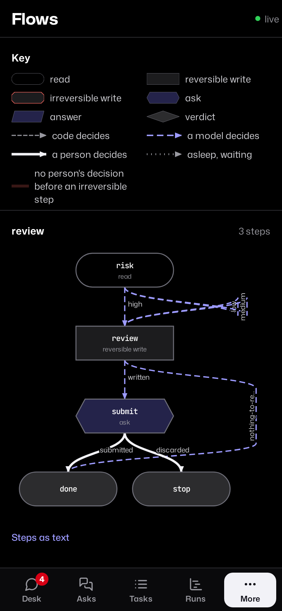

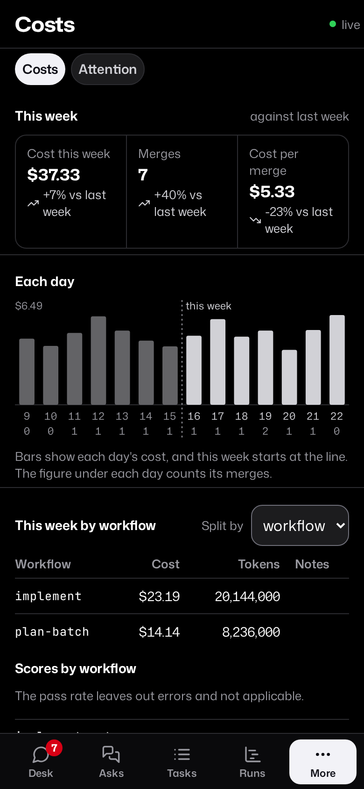

## The default view

```toml
[layout]
tabs = [
  { panel = "desk" },
  { panel = "asks" },
  { panel = "tasks" },
  { panel = "runs" },
  { panel = "inbox" },
  { panel = "reports" },
  { panel = "workflow" },
  { panel = "costs" },
]
```

On a phone, every leaf becomes a tab in the tree's order: the bottom bar shows the first four and
More holds the rest. On a wide screen, a `tabs` root becomes the rail beside the list and the
drawer; any other root is laid out as written. See [DESIGN.md](../../DESIGN.md#layout).

## Example

<!-- example: factory/views/default.toml -->
```toml
#:schema https://raw.githubusercontent.com/maxence-lefebvre/priory/main/docs/schemas/config/view.json
# The desk beside a column of the queue over the runs, replacing the default view.
[layout]
row = [
  { panel = "desk" },
  { column = [{ panel = "queue" }, { panel = "runs" }] },
]
```

## Errors

`priory check` reports each problem with its file and line:

| Message | Cause |
| ------- | ----- |
| `` unknown variant `kanban`, expected one of `desk`, ... `` | A panel name Priory does not ship |
| `` unknown variant `grid`, expected one of `row`, `column`, `tabs`, `panel` `` | A node key other than the four |
| `a row, column or tabs needs at least one child` | An empty `row`, `column` or `tabs` |
| `` `default` is also defined in views/default.toml `` | `default.toml` and `default.yaml` both exist |

`priory serve` and the daemon read the views when they start. Restart them after a change.

## Printing the views

`priory views [DIR] --json` prints the resolved views as `GET /api/views` serves them: the views
Priory ships, each replaced by the factory's view of the same name, then the factory's other views.
See [serve.md](serve.md#views). The [Herdr adapter](../adapters/herdr.md#installing) builds one
layout per view from this output.
